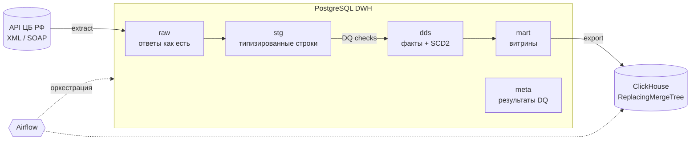

# DWH на данных ЦБ РФ: Airflow + PostgreSQL + ClickHouse

Учебно-демонстрационное хранилище данных: ежедневная загрузка официальных курсов валют и ключевой ставки Банка России, слоистая архитектура DWH, инкрементальная загрузка, SCD Type 2, проверки качества данных и аналитическая витрина в ClickHouse. Всё поднимается одной командой в Docker.

## Архитектура



| Слой | Объекты | Что происходит |
|---|---|---|
| `raw` | `cbr_response` | Ответ API сохраняется без изменений вместе с параметрами запроса: перезагрузку можно повторить без обращения к источнику |
| `stg` | `currency_rate`, `currency_ref`, `key_rate` | Разобранные и типизированные строки, привязанные к `load_id` |
| `dds` | `fct_currency_rate`, `fct_key_rate`, `dim_currency` | `MERGE` с хэш-сравнением (меняются только изменённые строки); справочник валют — SCD Type 2 |
| `mart` | `currency_rate_daily`, `key_rate_periods` | Изменение курса день к дню, скользящие средние за 7/30 торговых дней, ключевая ставка на дату (as-of join), периоды действия ставки (gaps and islands) |
| `meta` | `dq_result` | История всех проверок качества |

## DAG'и

| DAG | Расписание | Шаги |
|---|---|---|
| `cbr_currency_ref` | раз в неделю | extract → stage → DQ → SCD2 в `dim_currency` |
| `cbr_currency_rates` | ежедневно, catchup с `CBR_START_DATE` | extract → stage → DQ → MERGE в dds → пересборка витрины за 7 дней → экспорт в ClickHouse |
| `cbr_key_rate` | ежедневно, catchup | extract (окно 14 дней) → stage → DQ → MERGE в dds |

Решения, на которые стоит обратить внимание:
- **Идемпотентность.** Любой запуск можно перезапустить или прогнать бэкфиллом: stage заменяет строки своего `load_id`, dds обновляется через `MERGE`, витрина пересобирается за окно, ClickHouse схлопывает дубли через `ReplacingMergeTree(updated_at)`.
- **Data Quality.** Проверки с уровнями `error` (останавливает пайплайн) и `warn` (только фиксируется): минимальное число строк, положительные значения, уникальность ключа, формат ISO-кода, дата курса рядом с логической датой запуска, скачок курса больше 20 %.
- **Выходные и праздники.** ЦБ не устанавливает курсы на эти дни, поэтому дата курса берётся из ответа, а не из даты запуска. Ключевая ставка каждый раз перечитывается за 14 дней.
- **Надёжность.** Ретраи HTTP с экспоненциальной задержкой, ретраи задач Airflow, алерт о падении в лог и, по желанию, в Telegram.

## Запуск

Нужен Docker Desktop (выделите ему 4+ ГБ памяти).

```bash
cp .env.example .env
docker compose up -d --build
```

- Airflow: http://localhost:8080 (логин и пароль `admin` / `admin`)
- PostgreSQL DWH: `localhost:5432`, база `dwh`, пользователь `dwh` / `dwh`
- ClickHouse: http://localhost:8123, пользователь `dwh` / `dwh`

В Airflow включите DAG'и в таком порядке: `cbr_currency_ref` (запустите вручную) → `cbr_key_rate` → `cbr_currency_rates`. Бэкфилл с `CBR_START_DATE` запустится автоматически.

## Примеры запросов

```sql
-- PostgreSQL: самые волатильные валюты за последний месяц
SELECT char_code, round(stddev(change_pct), 3) AS volatility_pct
FROM mart.currency_rate_daily
WHERE rate_date >= current_date - 30
GROUP BY char_code
ORDER BY volatility_pct DESC
LIMIT 10;

-- PostgreSQL: история решений по ключевой ставке
SELECT date_from, date_to, rate, change_bps FROM mart.key_rate_periods ORDER BY date_from;

-- PostgreSQL: результаты последних DQ-проверок
SELECT dataset, check_name, severity, failed_rows, checked_at
FROM meta.dq_result ORDER BY checked_at DESC LIMIT 20;
```

```sql
-- ClickHouse: средний курс USD, EUR, CNY по месяцам
SELECT toStartOfMonth(rate_date) AS month, char_code, avg(vunit_rate) AS avg_rate
FROM cbr.currency_rate_daily FINAL
WHERE char_code IN ('USD', 'EUR', 'CNY')
GROUP BY month, char_code
ORDER BY month, char_code;
```

## Тесты

```bash
python -m venv .venv
.venv/Scripts/pip install -r requirements-dev.txt   # Linux/macOS: .venv/bin/pip
python -m pytest -q
```

Парсеры проверяются на реальных ответах API ЦБ (`tests/fixtures`). GitHub Actions на каждый push прогоняет тесты и валидирует `docker-compose.yml`.

## Стек

Apache Airflow 2.10 (TaskFlow API, LocalExecutor) · PostgreSQL 16 (MERGE, оконные функции, LATERAL) · ClickHouse 24.8 (ReplacingMergeTree) · Python 3.12 (requests, psycopg2, clickhouse-connect) · Docker Compose · pytest · GitHub Actions

## Что дальше

- Перенести трансформации dds → mart в **dbt** с тестами моделей
- Дашборд в **Apache Superset** поверх ClickHouse
- Поток событий через **Kafka** (например, публиковать изменения курсов)
